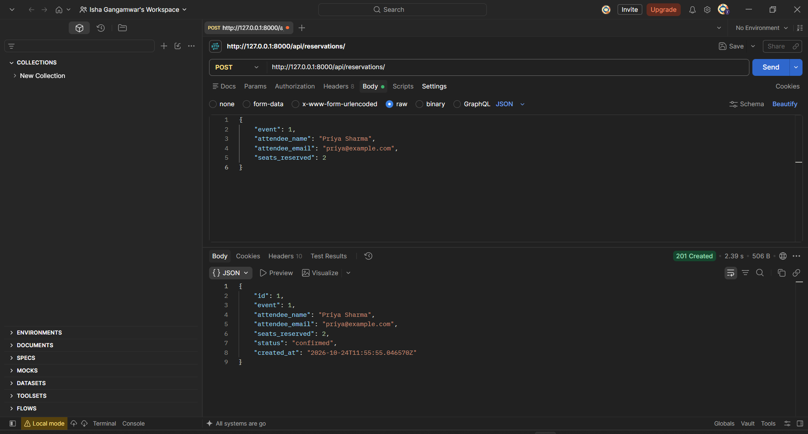
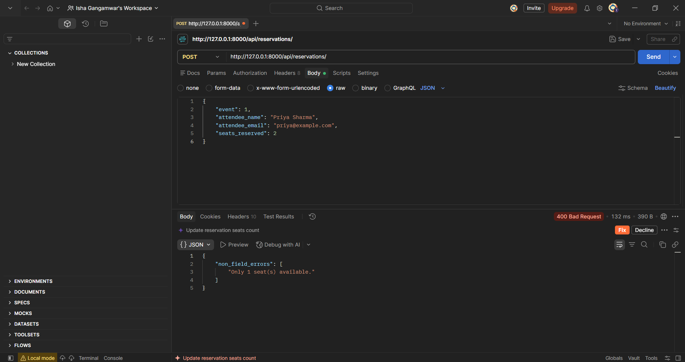
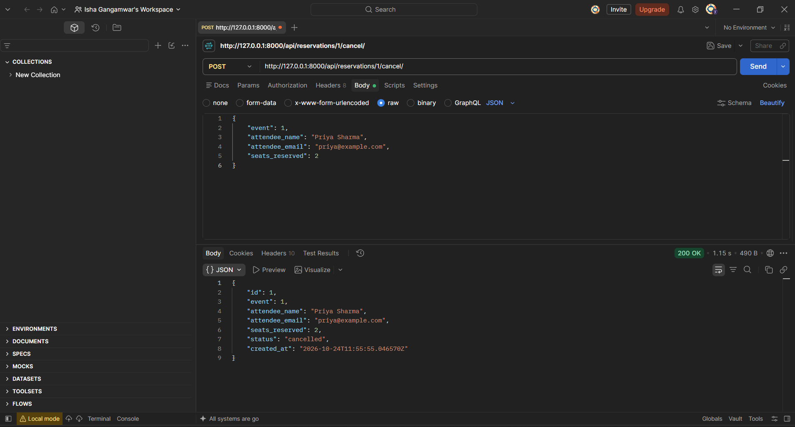

# EventHub

Backend API for a simple event ticketing platform. You can create events, reserve seats for them and cancel reservations. Seats are deducted from the event when a reservation is made and added back when it's cancelled.

Built with Django + Django REST Framework (ModelViewSets, serializers, DefaultRouter) and SQLite.

## How to run

```bash
git clone https://github.com/gisha10/Eventhub.git
cd eventhub

python -m venv venv
venv\Scripts\activate          # Windows
source venv/bin/activate       # Mac/Linux

python -m pip install -r requirements.txt
python manage.py migrate
python manage.py runserver
```

API runs at `http://127.0.0.1:8000/api/`. Opening that URL in the browser also shows DRF's browsable API.

Note: keep the `/` at the end of the URLs, otherwise POST requests fail.

## Project structure

```
eventhub/
├── manage.py
├── requirements.txt
├── db.sqlite3
├── eventhub/
│   ├── settings.py
│   └── urls.py
└── events/
    ├── models.py          # Event, Reservation
    ├── serializers.py     # EventSerializer, ReservationSerializer
    ├── views.py           # EventViewSet, ReservationViewSet
    ├── urls.py            # DefaultRouter
    ├── middleware.py      # RequestLoggingMiddleware
    └── migrations/
```

## Endpoints

### Events

| Method | URL | What it does |
|---|---|---|
| GET | `/api/events/` | List all events (ordered by date) |
| POST | `/api/events/` | Create an event |
| GET | `/api/events/{id}/` | Get one event |
| PUT / PATCH | `/api/events/{id}/` | Update an event |
| DELETE | `/api/events/{id}/` | Delete an event (its reservations get deleted too) |
| GET | `/api/events/?status=upcoming` | Filter by status |
| GET | `/api/events/?venue=bangalore` | Filter by venue (partial, case-insensitive match) |

Every event also returns `reservations_count`, which is the number of **confirmed** reservations for it.

Example body for POST:

```json
{
    "title": "PyCon India 2025",
    "venue": "NIMHANS Convention Centre, Bangalore",
    "date": "2025-09-20",
    "total_seats": 500,
    "available_seats": 500,
    "status": "upcoming"
}
```

If `available_seats` is more than `total_seats`, you get a 400.

### Reservations

| Method | URL | What it does |
|---|---|---|
| GET | `/api/reservations/` | List all reservations (newest first) |
| POST | `/api/reservations/` | Reserve seats, deducts them from the event |
| GET | `/api/reservations/{id}/` | Get one reservation |
| DELETE | `/api/reservations/{id}/` | Delete a reservation (seats go back to the event if it was confirmed) |
| GET | `/api/reservations/?event_id=1` | Reservations for one event |
| POST | `/api/reservations/{id}/cancel/` | Cancel a reservation, seats go back to the event. No body needed |

Example body for POST:

```json
{
    "event": 1,
    "attendee_name": "Priya Sharma",
    "attendee_email": "priya@example.com",
    "seats_reserved": 2
}
```

A reservation is rejected (400) when:
- `seats_reserved` is less than 1 → `"Must reserve at least 1 seat."`
- the event is completed or cancelled → `"Cannot reserve seats for a completed event."`
- not enough seats are left → `"Only 1 seat(s) available."`
- it's already cancelled and you call cancel again → `"Already cancelled."`

## Middleware

`events/middleware.py` has `RequestLoggingMiddleware`, which logs the method, path, status code and time taken for every request. Output in the terminal looks like:

```
POST /api/reservations/ - 201 - 0.01s
GET /api/events/ - 200 - 0.00s
```

I had to add a `LOGGING` config in `settings.py` for these to show up, because Django doesn't print `logger.info()` messages by default.

## Postman screenshots

### Successful reservation (201 Created)



### Overbooking (400 Bad Request)



### Successful cancellation



## Design decision

**Seat updates happen inside `transaction.atomic()` with `select_for_update()`.**

The brief says deducting seats in `create()` is enough for this assignment, but there's still a gap. `validate()` checks the seats, and then `create()` deducts them, so if two requests for the last seat come in at the same time, both can pass validation before either one saves. So in `create()` I:

1. open a transaction,
2. fetch the event again with `select_for_update()`, which locks that row until the transaction ends,
3. check the seat count again on this fresh copy,
4. deduct the seats and create the reservation.

If anything fails, both the seat change and the reservation are rolled back together, so the event's seat count and the reservations can't get out of sync. I did the same in the `cancel` action, where seats get added back.

(SQLite locks the whole database on writes, so `select_for_update()` doesn't do much there, but it would work properly on PostgreSQL or MySQL without any code changes.)

**Also:** I removed PUT/PATCH on reservations (`http_method_names` in `ReservationViewSet`). If someone changed `seats_reserved` on an existing booking, the event's `available_seats` wouldn't be updated and the numbers would be wrong. To change a booking you cancel it and make a new one.
